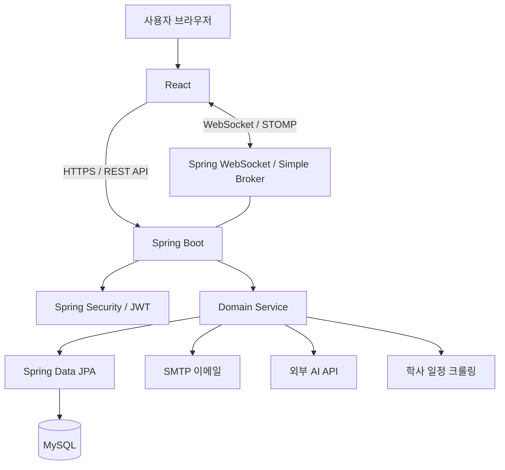

# 🏠 끼리끼리 (KKIRI-KKIRI)

> 생활 습관 기반 기숙사 룸메이트 매칭 플랫폼
> 


## 서비스 소개

**끼리끼리**는 기숙사 입사 예정 학생들이 자신의 생활 습관과 룸메이트 선호 조건을 바탕으로 서로에게 적합한 룸메이트를 효율적으로 찾을 수 있도록 지원하는 웹 서비스입니다.


## 기획 배경

기존에는 기숙사 입사가 확정된 학생들이 룸메이트를 구하기 위해 대학생 커뮤니티인 **에브리타임**을 활용했습니다.

학생들은 정해진 이미지 템플릿에 자신의 기본 정보, 생활 습관, 선호하는 룸메이트의 조건 등을 형광펜이나 펜으로 표시한 후, 이를 게시글로 업로드하는 방식으로 룸메이트를 찾았습니다.

하지만 이러한 방식에는 다음과 같은 문제점이 있었습니다.

1. **룸메이트 모집 게시글로 인한 커뮤니티의 정보 접근성 저하**
    - 기숙사 입사 시기가 되면 룸메이트 모집 게시글이 집중적으로 업로드됩니다.
    - 이로 인해 다른 정보성 게시글이 밀려나고, 학생들이 필요한 정보를 찾기 어려워집니다.
2. **이미지 기반 정보 공유로 인한 검색 및 필터링의 한계**
    - 생활 습관과 선호 조건이 이미지에 표시되어 있어 조건별 검색이나 필터링이 어렵습니다.
    - 원하는 조건에 부합하는 룸메이트를 체계적으로 탐색하기 어렵습니다.
3. **반복적인 게시글 확인으로 인한 비효율적인 탐색 과정**
    - 학생들은 자신과 잘 맞는 룸메이트를 찾기 위해 모집 게시글을 하나씩 열어 확인해야 합니다.
    - 게시글마다 서로 다른 정보를 비교해야 하므로 많은 시간과 노력이 소모됩니다.


## 프로젝트 목표

끼리끼리는 이러한 문제를 해결하기 위해 **기존의 이미지·게시글 중심 룸메이트 탐색 방식을 구조화된 설문 데이터 기반의 매칭 방식으로 전환**하고자 시작되었습니다.

학생들이 자신의 생활 습관과 룸메이트 선호 조건을 설문으로 입력하면, 이를 바탕으로 적합한 룸메이트를 추천하고 조건별 탐색이 가능하도록 설계했습니다.

이를 통해 다음과 같은 가치를 제공하고자 합니다.

- **효율적인 룸메이트 탐색:** 생활 습관 및 선호 조건을 기반으로 적합한 룸메이트 추천
- **편리한 정보 비교:** 구조화된 프로필과 필터링 기능을 통한 탐색 시간 단축
- **커뮤니티 이용 환경 개선:** 룸메이트 모집 공간을 분리하여 기존 커뮤니티의 정보 접근성 개선
- **사용자 중심의 매칭 경험:** 관심 프로필 등록과 채팅 기능을 통한 룸메이트 탐색 및 소통 지원

**끼리끼리는 단순한 룸메이트 모집 게시판을 넘어, 학생들이 서로의 생활 방식을 이해하고 자신에게 적합한 룸메이트를 찾을 수 있는 환경을 제공하는 것을 목표로 합니다.**


## 주요 기능

1. JWT 기반 인증 회원가입 / 로그인
    - 학교 이메일 인증번호 발송·검증, 회원가입, 로그인, 비밀번호 재설정 및 JWT 기반 인증
2. 내 프로필·생활 습관 설문
    - 취침·기상, 식사, 흡연, 청소 등 설문 필드를 작성·수정·저장
3. 선호 룸메이트 설문
    - 원하는 조건 설문 필드를 입력하고 가중치 설정·수정
4. 룸메이트 탐색 / 추천
    - 조건별 프로필 검색, 선호도 기반 매칭 점수 계산, 추천 및 상세 프로필 확인
5. AI 프로필 분석
    - 계산된 매칭 점수와 일치·불일치 항목을 AI API에 전달해 분석 결과 제공
6. 1:1 채팅
    - 채팅방 생성·조회, WebSocket/STOMP 메시지 전송, 메시지 기록·읽음 상태 관리
7. 생활관 커뮤니티
    - 게시글·댓글·답글 작성/조회/수정/삭제, 이미지, 좋아요, 익명 작성, 신고
8. 캘린더
    - 학사 일정 수집·조회 기능, 개인 일정 및 카테고리 관리


## System Architecture



백엔드는 **Controller → Service → Repository → Database** 구조를 기반으로 도메인별 코드를 분리했습니다. 인증·예외 처리·응답 형식 등의 공통 기능은 `global` 영역에서 관리합니다.


## Project Directory

```
roommate-matching-platform/
├── .github/workflows/ci.yml       # GitHub Actions CI
├── backend/
│   ├── src/main/java/com/kkirikkiri/
│   │   ├── admin/                  # 관리자
│   │   ├── auth/                   # 회원 인증·메일·비밀번호
│   │   ├── calendar/               # 학사 일정 수집·캘린더
│   │   ├── chat/                   # 채팅
│   │   ├── community/              # 게시글·댓글
│   │   ├── global/                 # 보안·설정·공통 응답
│   │   ├── matching/               # 매칭·관심 프로필·AI 분석
│   │   ├── report/                 # 신고
│   │   ├── survey/                 # 생활 패턴·선호 설문
│   │   └── user/                   # 사용자·프로필
│   ├── src/main/resources/         # Spring 설정·기준 데이터
│   ├── src/test/                   # 단위·통합 테스트
│   ├── src/e2e/                    # 격리된 E2E 실행 지원
│   ├── migrations/                 # 수동 DB 변경 스크립트
│   ├── API.md                      # API 문서
│   ├── ERD.md                      # ERD 문서
│   └── build.gradle
├── frontend/
│   ├── src/                        # React 페이지·컴포넌트·API
│   ├── e2e/                        # Playwright 브라우저 테스트
│   ├── public/                     # 정적 리소스
│   └── package.json
└── README.md
```


## 기술적 과제와 해결 방향

### 설문 저장 데이터의 일관성

초기 화면 상태와 브라우저 저장소만으로 설문을 관리할 경우, 다른 기기·재로그인·새로고침 시 서버의 매칭 입력과 UI가 불일치할 수 있습니다. 설문 **GET/PUT API를 실제 화면과 연결**하고, 작성 완료 여부를 서버 응답을 기준으로 판단하도록 개선했습니다.

### 관심 등록의 동시성 및 화면 동기화

동일 프로필에 대한 중복 관심 요청, 카드·상세·마이페이지 사이의 상태 불일치, 늦게 도착한 이전 세션 응답을 다뤘습니다. 서버의 관계 제약·트랜잭션 검증과 클라이언트의 요청/세션 구분, 성공 후 목록 재조회로 정합성을 유지하도록 구성했습니다.

### 매칭 점수의 결정성과 데이터 무결성

매칭 점수는 외부 AI가 임의 생성하지 않고, **서버의 명시적인 가중치 계산 로직**으로 산출합니다. 비교 입력과 가중치가 불충분한 경우 임의 점수를 만들지 않으며, 선호 조건과 생활 패턴에 따른 계산·갱신 경계를 테스트합니다. AI는 계산 결과를 설명하는 별도 단계입니다.

### 채팅 및 커뮤니티의 권한·정합성

채팅방 멤버 권한, 메시지 중복 전송, 재연결 후 조회, 댓글·답글 작성 결과 조회 실패, 게시글 이미지 접근 제어 등을 검증했습니다. 일부 흐름은 실제 브라우저·MySQL 기반 테스트로 재현하고, 중복 저장 또는 다른 사용자의 데이터 노출 위험을 줄이는 방향으로 보완했습니다.
